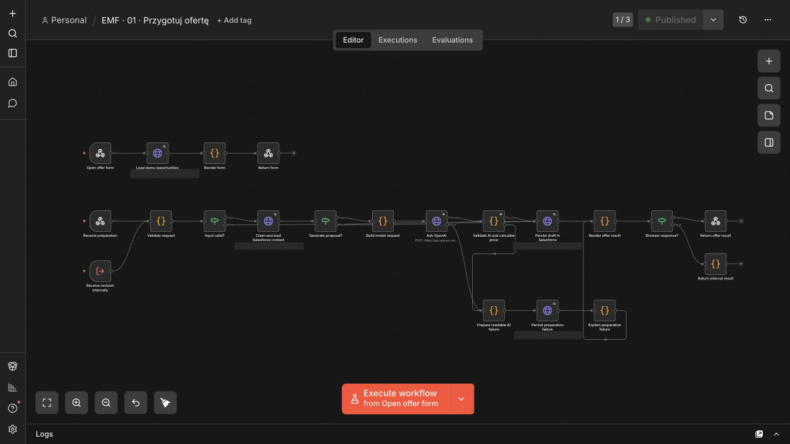
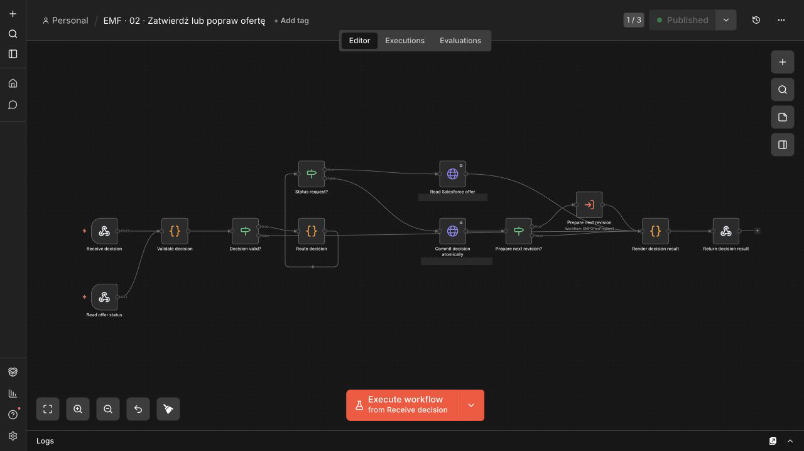
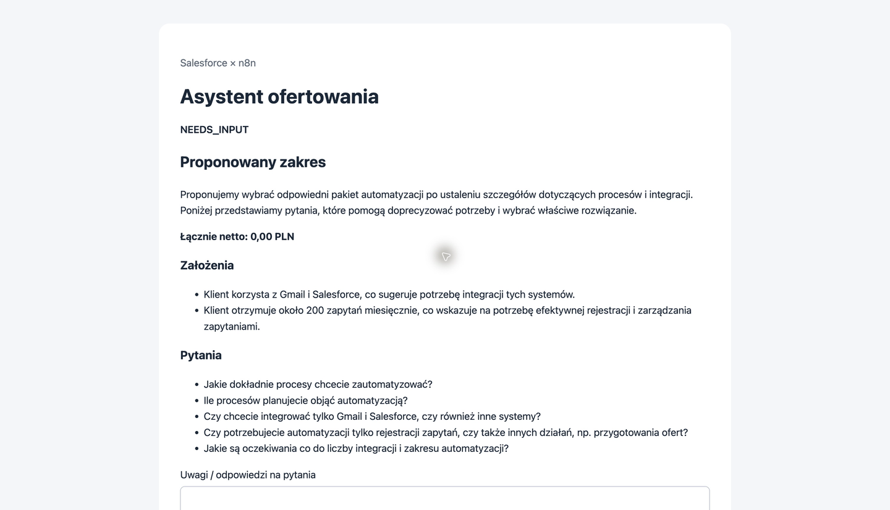
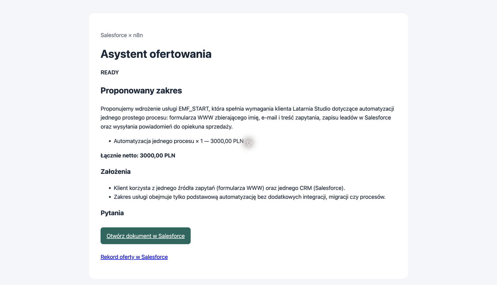
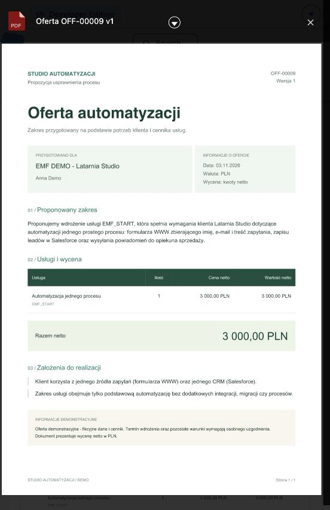

# Salesforce Offer Assistant

> An n8n and Salesforce Developer Edition demo that turns an opportunity and a service catalog into a reviewable quote. OpenAI proposes the scope, n8n calculates net prices, and a salesperson can request a revision, reject the offer, or approve it. Approval saves a PDF in Salesforce Files.

**Technologies** · n8n, Salesforce, Apex REST, OpenAI Responses API, JavaScript, OAuth 2.0.

## 1. Technical overview



| Workflow | Key nodes | Purpose |
| --- | --- | --- |
| [Prepare offer](workflows/EMFOfferPrepare1.json) | `Claim and load Salesforce context` → `Ask OpenAI` → `Validate AI and calculate price` → `Persist draft in Salesforce` | Loads the opportunity and three eligible price-book items. The model returns a structured scope with product codes, quantities, assumptions and questions. JavaScript prices each line in integer minor units using the catalog. |
| [Review and finalize](workflows/EMFOfferDecide01.json) | `Route decision` → `Commit decision atomically` → `Prepare next revision?` | Reads status, handles rejection and revision, or approves the current draft through Apex. A requested revision invokes the preparation workflow with the recorded feedback. |
| [Handle unexpected failures](workflows/EMFOfferError001.json) | `Execution failed` → `Normalize incident` → `Mark failed preparation` | Uses the n8n Error Trigger to record a failed preparation in Salesforce when the original execution can be matched. Workflow 01 handles model request and output errors in its own failure branch. |



Salesforce stores offer state and revisions. A request key deduplicates submissions. Apex rejects stale revisions, checks that CRM and price-book data still match the saved snapshot, and revalidates the quote amounts. Approval locks the offer row, renders the A4 PDF with `Blob.toPdf`, and saves the file, its links to the opportunity and offer, and the `READY` status in one transaction. Repeated approval of the same revision returns the existing file.

## 2. Demo walkthrough

1. Open `http://localhost:5678/webhook/emfire/offers` in the browser and select the seeded `EMF DEMO - Obsługa zapytań` opportunity.
2. Ask for one website form that collects inquiries, records them in Salesforce, and notifies the salesperson. Review the proposed scope, assumptions and net amount in PLN.
3. Ask for a revision with feedback, reject the quote, or approve the current draft. An underspecified request can enter `NEEDS_INPUT`, display questions and block approval until the information is supplied.
4. On `READY`, select **Otwórz dokument w Salesforce** to view the generated PDF.

| Missing information | Approved offer |
| --- | --- |
|  |  |



## 3. Setup

Use Node.js 22 or later, Salesforce CLI (`sf`), an isolated Salesforce Developer Edition org with PLN as its default currency, and a separate self-hosted n8n instance for the demo. The integration run used n8n 2.9.2.

1. Authenticate the Salesforce CLI and deploy the metadata. The seed script creates fictional records, activates the standard price book if needed, and adds the three demo services. The alias `offer-demo` is local to your CLI.

   ```sh
   cd salesforce
   sf org login web --alias offer-demo
   sf project deploy start --source-dir force-app --target-org offer-demo \
     --test-level RunSpecifiedTests --tests EmfireOfferApiTest
   sf org assign permset --name Emfire_Offer_Demo --target-org offer-demo
   sf apex run --file seed-demo.apex --target-org offer-demo
   cd ..
   ```

   Assign `Emfire_Offer_Demo` to the OAuth integration user if it differs from the CLI user. The Apex endpoint checks the org edition and the `Emfire_Offer_Access` custom permission.

2. Configure a Salesforce External Client App for OAuth 2.0 authorization code with PKCE and scopes `api refresh_token`. Use the redirect URI shown by your n8n OAuth2 credential. For local n8n this is `http://localhost:5678/rest/oauth2-credential/callback`. Use the authorization and token endpoints of your Salesforce org (`/services/oauth2/authorize` and `/services/oauth2/token`). [Salesforce REST OAuth documentation](https://developer.salesforce.com/docs/platform/api-rest/guide/intro-oauth-and-connected-apps.html)

3. Copy [bindings.example.json](bindings.example.json) to the local builder configuration, replace `salesforceBase` with your org's actual API origin and set `n8nBase` to the URL reachable from your browser. The builder writes the three workflow files in place. Regenerate without the local bindings before sharing any exports.

   ```sh
   mkdir -p .runtime
   cp bindings.example.json .runtime/bindings.json
   # Edit .runtime/bindings.json for your demo instance before building.
   node scripts/build-workflows.js
   ```

4. Import into an isolated n8n instance to keep the workflow IDs used by the revision and error workflow references. The CLI can overwrite workflows with matching IDs. [n8n CLI import documentation](https://docs.n8n.io/hosting/cli-commands/#import-workflows-and-credentials)

   ```sh
   n8n import:workflow --separate --input=workflows/
   ```

5. Bind credentials in the n8n editor. Check that the decision workflow's **Prepare next revision** points to the preparation workflow and that both main workflows use the error workflow in their settings. Publish the error workflow first, then publish preparation and decision.

   | Nodes | n8n credential |
   | --- | --- |
   | All four Webhook nodes | Dedicated HTTP Basic Auth |
   | Salesforce HTTP Request nodes in all three workflows | Generic OAuth2 API with PKCE |
   | `Ask OpenAI` | OpenAI API |

The demo uses a shared browser credential and records the Salesforce integration user as the approver. It processes fictional CRM data, sends opportunity details and instructions to OpenAI, and stores execution data in n8n. Pricing covers three seeded services and net PLN amounts. The flow ends at the Salesforce file and has no outbound email step.

## 4. Validation

Run the local JavaScript tests and check the workflow graph, webhook authentication, model response validation and deterministic pricing.

```sh
node --test tests/*.test.js
```

- **Portfolio checkout** · 23 JavaScript tests passed. The three inactive exports were imported into a clean local n8n 2.9.2 database.
- **Salesforce demo run, 2026-11-03** · Nine Apex tests and 12 live endpoint guard checks passed. A real OpenAI proposal led to a Salesforce PDF at `READY`. Two concurrent approvals both returned HTTP 200 and produced one file version. An earlier live run also exercised feedback-driven revision and the missing-input and rejection paths.
- **PDF checks** · The generated A4 quote opened in the Salesforce preview from the offer result page. A separate deterministic layout fixture exercised three A4 pages with long text and Polish characters.
